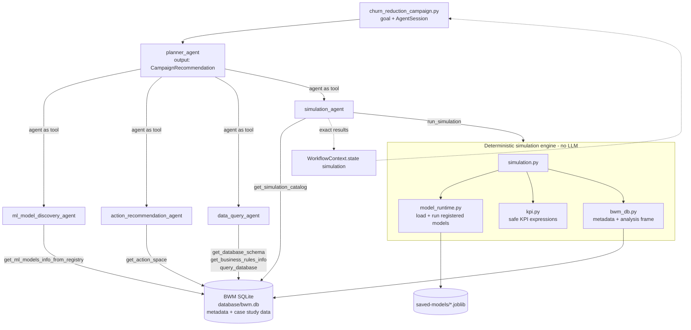

# bwm-paper

An agentic system that recommends business actions to reach a stated goal. It discovers the registered prediction models and feasible actions, queries the data, runs what-if simulations, and checks each scenario against the goal.

Everything it knows about the domain comes from the **BWM** metadata database: entities, attributes, prediction models, features, actions and KPIs. The agent code has no knowledge of churn, subscriptions or prices. The BWM churn case study is registered as organisation 1.

```
goal (natural language)
  "Reduce the churn rate of high frequency subscriptions (top 10%) by at least
   0.1 percentage point. Total monthly revenue must not decline by more than $200,000"
        │
        ▼
recommendation (structured): goal interpretation, models and KPIs used, baseline,
scenario table, verdict (feasible / infeasible), recommended action, trade-offs, caveats
```

## Architecture



### Design principles

- **LLMs orchestrate; Python calculates.** The agents interpret the goal, choose KPIs, segments and actions, and explain the result. Every number comes from the deterministic engine, and the agents are told to report tool output verbatim. The exact simulation result is also stored in `WorkflowContext.state["simulation"]` and printed after the recommendation, so the LLM's summary can be checked against it.
- **Metadata-driven.** Models, features, actions and their levels, KPIs, and how entities join all come from the BWM tables. A new case study, model, action or KPI is added by inserting rows, not by changing code.
- **Revenue constraint is the only built-in business concept.** A goal may cap how much the revenue KPI may decline. Which KPI counts as revenue, and its formula, come from metadata (`kpi.category = 'revenue'`).
- **Errors are shown to the model.** Tools use `agent/tool_errors.py::tool_error_message` in place of the SDK default, which hides exceptions. The agent sees the real message, for example `Unknown KPI 'churn'; choose from [...]`, corrects its inputs and retries. Errors are also logged.
- **Read-only data access.** The database is opened with `mode=ro`. Ad hoc queries must be a single `SELECT`/`WITH` statement and are capped at 200 rows.

## Agents (`src/agent/`)

All agents use the [OpenAI Agents SDK](https://github.com/openai/openai-agents-python) (`openai-agents`) with `model='gpt-6.1-sol'`. `planner_agent` calls the other agents as tools (`Agent.as_tool`). The run context (`WorkflowContext`) is shared with the nested agents.

| Agent | Role | Tools |
|---|---|---|
| `planner_agent` | Controller. Runs the workflow: models → actions → baseline data → simulation → recommendation. Returns `CampaignRecommendation` (pydantic). | the four agents below |
| `ml_model_discovery_agent` | Finds the registered prediction models relevant to the goal | `get_ml_models_info_from_registry` |
| `action_recommendation_agent` | Picks the relevant feasible actions and their levels | `get_action_space` |
| `data_query_agent` | Answers data questions (baseline sizes, cutoffs, averages) and reports business rules | `get_database_schema`, `get_business_rules_info`, `query_database` |
| `simulation_agent` | Maps the goal to a simulation spec (segment filters, objective KPI, target, revenue cap), runs it, and reports the scenarios | `get_simulation_catalog`, `run_simulation` |

`AgentSession` (`agent_session.py`) wraps `Runner.run` with an in-memory `SQLiteSession`. Tracing is disabled, so no trace data is sent to OpenAI.

## Simulation engine

| Module | Responsibility |
|---|---|
| `bwm_db.py` | Metadata loaders (`get_prediction_models`, `get_feasible_actions`, `get_kpis`, `get_attributes`, `get_relationships`, `get_schema`, `get_business_rules`), the guarded `run_select_query`, and `load_analysis_frame`. That function builds one row per unit entity with the requested `entity.attribute` columns, joining related entities along `entity_relationship` (only joins that don't multiply rows: 1:1 and N:1). |
| `model_runtime.py` | `PredictionModel` loads any registered model by `artifact_format` and maps database attributes to model inputs (`model_input_name`, `input_order`, checked against the artifact's `feature_names_in_`). It returns the probability of `positive_class`, a value or a class, then applies the registered `output_transform` (currently `prior_correction`). New formats and transforms are added to `ARTIFACT_LOADERS` / `OUTPUT_TRANSFORMS`. |
| `kpi.py` | Safe KPI evaluation. The expression is parsed with `ast`, and only `entity.attribute` names, numbers, arithmetic, comparisons, `and`/`or`/`not` and `abs`/`log`/`exp`/`minimum`/`maximum` are allowed. The aggregation (`sum`/`mean`/`count`/`min`/`max`) is then applied. |
| `simulation.py` | `simulate(segment_filters, goal, action_ids, include_combinations)`: the scenario engine described below. `SegmentFilter` and `GoalSpec` are pydantic models and double as the tool's JSON schema. |

### How a simulation runs

1. **Resolve the spec.** The objective KPI defines the *unit entity*, e.g. `subscription`. The revenue KPI defaults to the one with category `revenue`. Segment attributes may be given as `entity.attribute` or as an unambiguous bare name.
2. **Build the analysis frame.** Load every attribute used by the unit's models, the KPIs, the segment filters and the actions. Score every model of the unit entity to fill its prediction attribute; predictions are always recomputed, never read from the stored table. The frame is cached per process.
3. **Define the segment.** All filters must hold. Supported filters are `top_share` / `bottom_share` (e.g. 0.10 = top 10%, strict `> quantile(1 − share)`), `gt` `ge` `lt` `le` `eq` `ne`, `between` and `in`. Filters may use model predictions, e.g. the top 5% by churn risk.
4. **Enumerate scenarios.** The baseline, every level of every selected action, and (by default) every combination of levels across different actions, up to 500 scenarios.
5. **Apply and re-score.** For each scenario, apply the action levels to segment rows only (`scale`: x·v, `add`: x+v, `set`: v), and re-score only the models whose inputs changed.
6. **Evaluate.** Compute the objective KPI over the segment or the whole population, the revenue KPI over the whole population, and every other KPI of the unit entity. The target can be `absolute`, `percentage_points` (fraction KPIs only) or `relative_percent` of the baseline.
7. **Recommend.** Return the verdict and the scenario ids for:
   - `recommended`: the feasible scenario with the smallest revenue loss
   - `best_within_budget`: the largest improvement within the revenue cap
   - `cheapest_meeting_target`: the smallest revenue loss that reaches the target
   - `largest_objective_improvement`: the largest improvement overall

## BWM metadata model (`database/bwm_ddl.sql`)

Every table except `model_type` is partitioned by `org_id`.

| Table | Purpose |
|---|---|
| `organization`, `model_type` | Tenants and model types |
| `entity`, `attribute` | Business entities (tables) and their attributes; `data_type` (`numeric`/`categorical`/`date`/`id`) and `is_key` |
| `entity_relationship` | How entities join (`from_entity.from_attribute → to_entity.to_attribute`, cardinality `1:1`/`N:1`/`1:N`) |
| `prediction_model` | Registered models: the prediction attribute they populate, the unit entity they score, the artifact path and format, `prediction_kind`, `positive_class`, `output_transform` (JSON) and `decision_threshold` |
| `predictive_feature` | A model's input attributes, with the input column name the artifact expects and its order |
| `feasible_action` | Actions on an attribute, with `action_type` (`scale`/`add`/`set`) |
| `action_level` | The allowed values of each action, with labels (e.g. scale 0.85 = "15% discount on monthly cost") |
| `kpi`, `kpi_attribute` | Named metrics: `aggregation(expression)` over the rows of a unit entity, with a `unit` and a `category` (`outcome`/`revenue`/`volume`). The attributes used are recorded in `kpi_attribute` and checked against the expression. |
| `business_rule`, `rule_entity_link` | Business rules and the entities and attributes they govern. They are reported to the planner but not enforced. |

### BWM case study (org 1, `database/bwm_case_study_ddl.sql`)

- **Data tables:** `subscription` (monthly_cost, tenure_days), `content_consumption_statistics` (frequency, breadth, recency), and `subscription_predictions` (churn_probability). Each has one row per `subs_id`, loaded from the inference dataset by `database/load_case_study_data.py`.
- **Model 1:** logistic regression churn model (`saved-models/churn_model_lr.joblib`). It scores `subscription` and uses frequency, breadth, tenure_days (as model input `tenure`) and monthly_cost, with prior-corrected probabilities. See `notebooks/Train.ipynb`.
- **Action 1:** scale `subscription.monthly_cost` by 0.95, 0.90, 0.85, 0.80 or 0.75 (a 5–25% discount).
- **KPIs:**
  - `mean_churn_probability`: mean predicted churn probability (outcome)
  - `predicted_churn_rate`: share of subscriptions above the decision threshold (outcome)
  - `expected_monthly_revenue`: `sum(monthly_cost × (1 − churn_probability))` (revenue)
  - `subscription_count`: number of subscriptions (volume)

## Running

Requires Python ≥ 3.14 and [uv](https://docs.astral.sh/uv/).

```bash
uv sync

# Build the BWM database: metadata, case study tables and data
uv run python database/build_database.py --force

# Run the campaign recommender (needs an OpenAI API key)
export OPENAI_API_KEY=...
cd src && uv run python churn_reduction_campaign.py
```

The output is the planner's `CampaignRecommendation` as JSON, followed by the exact scenario table from the simulation engine.

| Environment variable | Default | Purpose |
|---|---|---|
| `OPENAI_API_KEY` | none | LLM access for the agents |
| `BWM_DB_PATH` | `database/bwm.db` | BWM database to use |
| `BWM_ORG_ID` | `1` | Organisation whose metadata is used |

## Extending

None of these need code changes. Insert the rows, rebuild or update the database, and rerun.

- **New action:** a `feasible_action` row (entity, attribute, `action_type`) plus its `action_level` rows.
- **New KPI or goal metric:** a `kpi` row with an expression over `entity.attribute` names (prediction attributes included), plus its `kpi_attribute` rows.
- **New model:** a `prediction_model` row (artifact, unit entity, prediction attribute, kind, transform), plus `predictive_feature` rows that map attributes to model inputs.
- **New entity:** `entity` and `attribute` rows, plus an `entity_relationship` row that joins it to the unit entity.
- **New organisation or case study:** a separate DDL script like `bwm_case_study_ddl.sql`, run with `BWM_ORG_ID` set to the new org.

Code changes are needed only for a new artifact format or output transform (`model_runtime.py`) or a new action type (`simulation.py::_apply_action`).

## Limitations and caveats

- **Not causal.** Simulated effects are sensitivities of models trained on observational data, not causal estimates of how customers would respond.
- **Uniform actions.** Each scenario applies an action level uniformly to the whole segment. There is no per-row optimisation.
- **Business rules are not enforced.** The planner reports them, but the engine doesn't apply them.
- **No derived features.** Features must exist as stored attributes. For example, `monthly_cost` is precomputed when the data is loaded.
- **ERD out of date.** The Lucidchart ERD exports (`database/autobus_ddl.csv`, `database/bwm_case_study_ddl.csv`) still use the former name AUTOBUS, and don't yet include the simulation metadata tables and columns added in `bwm_ddl.sql`.

## Repository layout

```
database/        BWM DDL, BWM case study DDL, build and load scripts, bwm.db
datasets/        training and inference datasets
notebooks/       Train.ipynb (model training), Inference.ipynb (inference, discount what-ifs)
saved-models/    churn model artifact and its metadata JSON
src/
  churn_reduction_campaign.py   entry point: goal → recommendation
  agent/                        agents, simulation engine, BWM access
```
